# Hey, I'm Soheab 👋

Junior software developer. I've been coding since 2017, mostly in Python, PHP, and JavaScript.

Most of what I build involves Discord in some way, using and abusing its API. I mostly work on APIs and integrations, with some open-source and AI tinkering on the side.

[Website](https://soheab.com) · [Discord Badges](https://discordbadges.soheab.com/)

## Projects

- [mijndak.py](https://github.com/Soheab/mijndak.py): An unofficial async Python client for DAK, the Dutch social housing platform.
- [stagemarkt.py](https://github.com/Soheab/stagemarkt.py): A Python wrapper for Stagemarkt's undocumented APIs.
- [ovpay.py](https://github.com/Soheab/ovpay.py): An unofficial async Python client for the OVpay API.
- [Commit Lens](https://github.com/Soheab/commit-lens): A Chrome extension with richer commit stats and custom commit-line templates.
- [Discord Badges](https://discordbadges.soheab.com/): Discord activity badges for your README, like the ones below.

## Around Discord

  
  
  
  
  

## What I use

Python, PHP, and JavaScript are my usual picks. I also work with MySQL, PostgreSQL, and SQLite.

## The numbers

  
  

  

  
GitHub trophies

   
  

